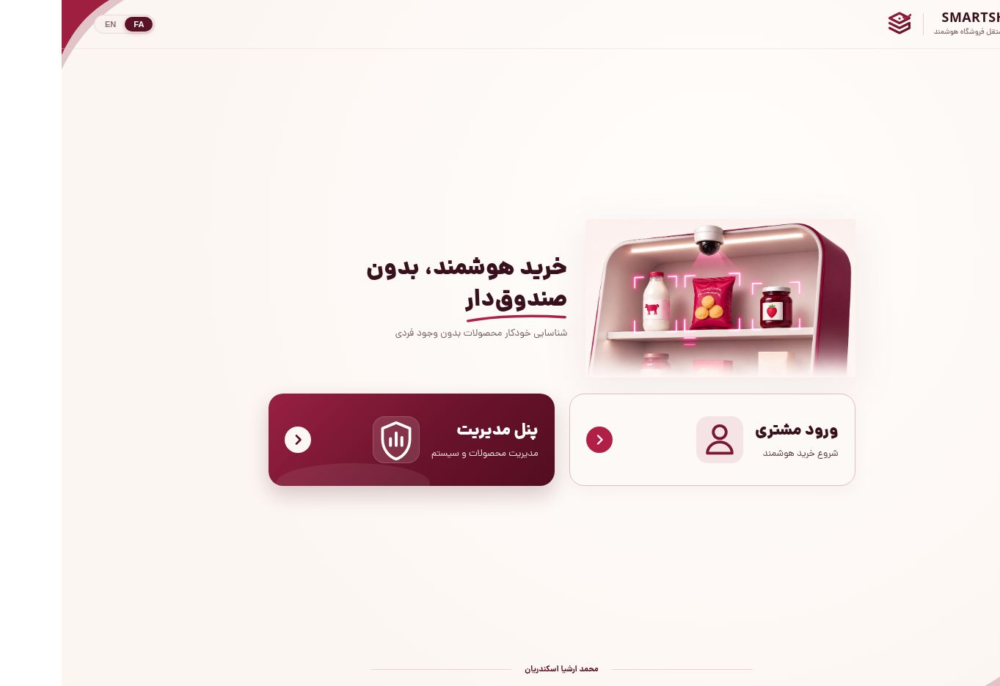
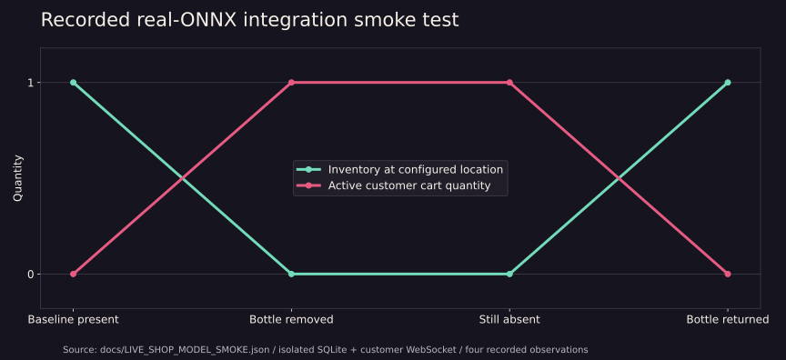
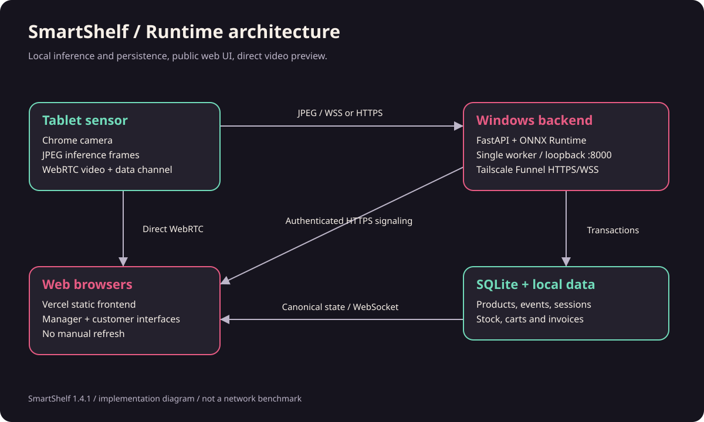
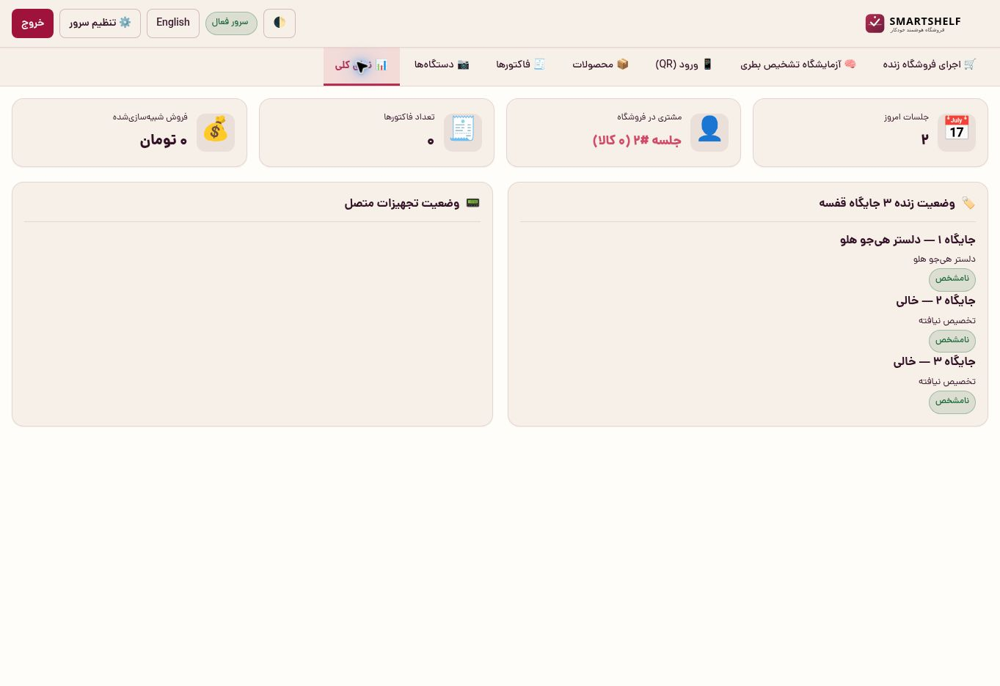
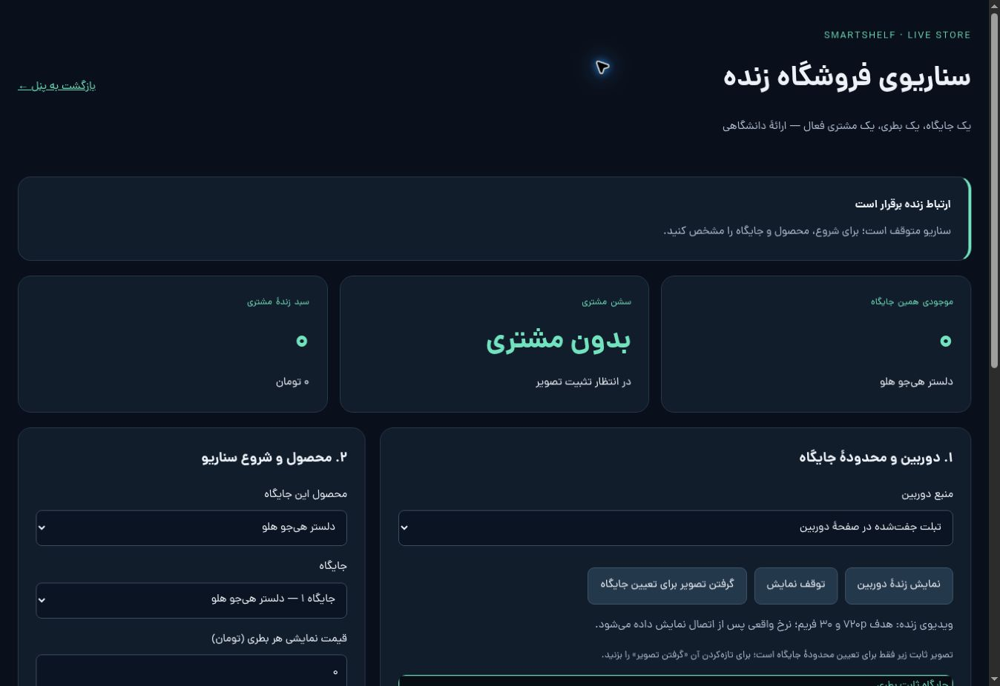
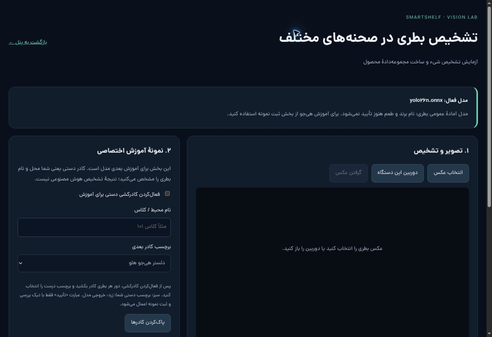
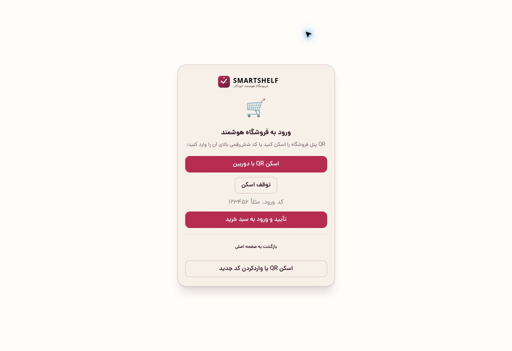

# SmartShelf — قفسه و فروشگاه هوشمند با پردازش تصویر

**پروژهٔ دانشگاهی محمد ارشیا اسکندریان** · [English](README.md) · [گالری تصاویر](docs/GALLERY.md)



## هدف پروژه

هدف SmartShelf اجرای یک سناریوی قابل‌حمل فروشگاه بدون صندوق با دوربین یک تبلت معمولی است: مشتری با QR یا کد مدیر وارد می‌شود، یک سشن خرید می‌گیرد، بطری را از جایگاه برمی‌دارد و محصول به‌صورت زنده به سبدش اضافه می‌شود؛ با برگرداندن بطری، محصول از سبد کم و موجودی دوباره اضافه می‌شود. هیچ‌کدام از دو طرف به رفرش دستی نیاز ندارند.

نسخهٔ فعلی برای **یک جایگاه، یک بطری و یک مشتری فعال** طراحی شده است. مدل آماده حضور «بطری» را تشخیص می‌دهد؛ نام برند و طعم از مدل تأیید نمی‌شود. محصول و قیمت را مدیر به جایگاه نسبت می‌دهد. این نسخه یک ارائهٔ دانشگاهی است و پرداخت بانکی واقعی یا رهگیری چند مشتری هم‌زمان ندارد.

## روند توسعه

پروژه با تطبیق دو مرجع حاضر/خالی و تعیین ROI شروع شد. روش اولیه در محیط ثابت جواب داد، اما جابه‌جایی بین کلاس‌ها و تغییر پس‌زمینه محدودیت آن را نشان داد. برای همین مسیر اصلی به تشخیص شیء با YOLO26n، اجرای محلی ONNX و تأیید زمانی چند فریم تغییر کرد. ابزار قدیمی دو‌مرجعی برای مطالعه و کالیبراسیون همچنان وجود دارد، ولی لازمهٔ سناریوی فعلی بطری نیست.

ابتدا بسته‌بندی استقرار Railway آماده شد؛ محدودیت حساب مانع ساخت سرویس شد و مسیر انتخابی به بک‌اند دائمی روی Windows، دیتابیس SQLite، تونل Tailscale Funnel و فرانت‌اند Vercel تغییر کرد. سپس سبد/موجودی زنده، اتصال پایدار دوربین، پخش WebRTC و کنترل واقعی شروع/توقف تکمیل شدند.

| نسخه/مرحله | نتیجه |
| --- | --- |
| پایه | مقایسهٔ دو مرجع حاضر/خالی با OpenCV و ماشین حالت |
| 1.2.0 | مدل عمومی بطری و ابزار ثبت/بررسی نمونه برای آموزش آینده |
| 1.3.0 | سناریوی زندهٔ انبار، سبد و سشن مشتری |
| 1.3.1 | توکن امضاشدهٔ دوربین، تأیید دریافت فریم، مسیر جایگزین HTTPS و اسکن QR |
| 1.3.2 | رفع خطایی که پس از موفقیت دوربین، اشتباهاً خطای مجوز نشان می‌داد |
| 1.4.0 | جایگزینی عکس‌های دوره‌ای با ویدیوی WebRTC |
| 1.4.1 | فرمان واقعی شروع/توقف از پنل، تأیید تبلت و بررسی فریم تازه در سرور |

[شرح کامل تصمیم‌ها و مسیر توسعه](docs/DEVELOPMENT_JOURNEY.md)

## سناریوی خرید

۱. مدیر محصول، قیمت و محدودهٔ ثابت جایگاه را انتخاب و سناریوی دانشگاهی را فعال می‌کند.
۲. تبلت با کد شش‌رقمی مخصوص دوربین جفت می‌شود و فریم به سرور می‌فرستد.
۳. حضور پایدار بطری، موجودی اولیه را مشخص می‌کند؛ این مرحله خرید محسوب نمی‌شود.
۴. مشتری با QR یا کد کوتاه‌عمرِ ورود، سشن خرید می‌گیرد.
۵. برداشتن پایدار بطری، موجودی را از ۱ به ۰ و تعداد سبد همان مشتری را از ۰ به ۱ می‌برد.
۶. برگشت پایدار بطری، عملیات را برای سشن صاحب برداشت معکوس می‌کند.

ابهام، تغییر سشن، فریم تکراری یا قطع تصویر نباید به خرید حدسی منجر شود. تأیید سناریو حداقل سه مشاهده و ۱٫۲ ثانیه زمان می‌خواهد؛ فاصلهٔ بیش از ۲٫۵ ثانیه بین فریم‌ها پیوستگی تشخیص را قطع می‌کند.



## فناوری‌ها و معماری



| بخش | فناوری |
| --- | --- |
| بک‌اند | Python، FastAPI، Uvicorn، Pydantic |
| دیتابیس | SQLite و SQLAlchemy |
| تشخیص بطری | YOLO26n به‌صورت ONNX، ONNX Runtime، OpenCV، NumPy و Pillow |
| مسیرهای پژوهشی قبلی | SIFT/ORB، RANSAC، embeddingهای MobileNetV2 |
| رابط وب | HTML، CSS، JavaScript و Canvas بدون نیاز به بیلد فرانت‌اند |
| تصویر زنده | WebRTC، ICE، STUN و TURN اختیاری |
| کنترل تبلت | RTCDataChannel قابل‌اعتماد با تأیید اجرای فرمان |
| فریم هوش مصنوعی | WSS احرازهویت‌شده و مسیر جایگزین HTTPS با کنترل فشار |
| به‌روزرسانی مشتری و مدیر | WebSocket با وضعیت مرجع سرور |
| بارکد و QR | zxing-cpp و jsQR |
| استقرار | Windows، PowerShell، Tailscale Funnel و Vercel |
| آزمون | pytest و هشت آزمون اجرایی JavaScript |

ویدیوی نمایشی، فریم هوش مصنوعی و رویدادهای سبد سه مسیر متفاوت‌اند. WebRTC با هدف 720p و ۳۰ فریم اجرا می‌شود، اما نرخ واقعی از آمار گیرنده خوانده می‌شود و به دوربین و شبکه بستگی دارد. صرف دیدن ویدیو ثابت نمی‌کند فریم برای پردازش به سرور رسیده است؛ دکمهٔ شروع این موضوع را جداگانه بررسی می‌کند.

## نصب

```powershell
git clone https://github.com/arschia/SmartShelf.git C:\SmartShelf
cd C:\SmartShelf
.\INSTALL-SMARTSHELF.bat
.\START-SMARTSHELF.bat
```

نصب ویندوز برای Python 3.14 استاندارد ۶۴ بیتی آماده شده است. اسکریپت نصب، محیط مجازی، وابستگی‌ها و تنظیمات خصوصی را می‌سازد. پس از نصب و ورود به Tailscale، فایل `ENABLE-FUNNEL.bat` را جداگانه اجرا و آدرس HTTPS بک‌اند خودتان را تنظیم کنید.

در مخزن عمومی، آدرس بک‌اند فرانت‌اند خالی است؛ پروژهٔ دانلودشده به کامپیوتر صاحب پروژه متصل نمی‌شود. پورت 8000 را روی مودم یا فایروال به اینترنت باز نکنید. کامپیوتر میزبان باید روشن، آنلاین و بدون Sleep باشد. جزئیات در [راهنمای نصب](docs/SETUP.md) و [تنظیمات](docs/CONFIGURATION.md) آمده است.

## تصاویر رابط

| پنل مدیریت | فروشگاه زنده |
| --- | --- |
|  |  |

| آزمایشگاه بطری | ورود مشتری |
| --- | --- |
|  |  |

تصاویر، نمای واقعی رابط در زمان ثبت‌اند؛ آزمایشگاه در حالت آماده و سناریو در حالت متوقف ثبت شده‌اند. داده‌های نمونهٔ Styleguide، آمار واقعی فروش نیستند. تصاویر خصوصی مرجع، کدهای فعال و اطلاعات محرمانه منتشر نشده‌اند. [گالری کامل و توضیح تصاویر](docs/GALLERY.md)

## وضعیت مدل و آزمون‌ها

- مدل عمومی آمادهٔ بطری استفاده شده است؛ آموزش اختصاصی معتبر برای برند هی‌جو ادعا نمی‌شود.
- کادرکشی دستی و افزودن مرجع، به‌تنهایی آموزش شبکهٔ عصبی نیست. ابزار آموزش و notebook برای ادامهٔ کار وجود دارد.
- ۱۶۰ تست بک‌اند در محیط آزمایشی ایزوله پاس شدند.
- هشت harness اجرایی JavaScript، منطق واقعی رابط را با مرزهای کنترل‌شدهٔ مرورگر و شبکه بررسی می‌کنند.
- آزمون یکپارچه با مدل ONNX واقعی، دیتابیس آزمایشی و WebSocket، حضور → برداشت → نبودن تکراری → برگشت را بررسی کرده است.
- در بررسی ۴۲ عکس مرجع، ۳۹ تصویر حداقل یک تشخیص بطری داشتند؛ این عدد بدون برچسب‌گذاری کامل، معیار دقت یا mAP نیست.
- صاحب پروژه پس از نسخهٔ 1.4.1 در ۵ نوامبر ۲۰۲۶ عملکرد دستگاه واقعی را موفق گزارش کرد. این گزارش، تضمین کارکرد در همهٔ محیط‌ها و شبکه‌ها نیست.

[جزئیات آزمون‌ها](docs/TESTING.md) · [کارت مدل](docs/MODEL_CARD.md) · [راهنمای رفع خطا](docs/TROUBLESHOOTING.md)

## داده و امنیت

فایل `.env`، PIN واقعی، کلید امضا، دیتابیس، پشتیبان‌ها و مجموعهٔ عکس‌های خصوصی در مخزن قرار نمی‌گیرند. فریم‌های زنده در حافظه پردازش می‌شوند؛ تصاویر محصول و نمونه‌های آموزشی فقط در صورت ثبت صریح ذخیره می‌شوند. سبد و موجودی در سرور تعیین می‌شوند. فروشگاه عادی به‌صورت پیش‌فرض بسته است و سناریوی دانشگاهی باید صریحاً فعال شود.

فونت نسخهٔ عمومی Vazirmatn با مجوز OFL است؛ نام Dana در CSS صرفاً برای سازگاری با رابط قبلی باقی مانده و فایل‌های فونت اختصاصی در مخزن توزیع نشده‌اند. مجوزهای مدل‌ها و کتابخانه‌ها در [اطلاعیهٔ اجزای ثالث](THIRD_PARTY_NOTICES.md) آمده‌اند.

## ادامهٔ پژوهش

ارزیابی مستقل در چند کلاس، آزمون انسداد و نور، تشخیص چند بطری و چند جایگاه، انتساب چند مشتری، آموزش مدل اختصاصی برند و استقرار TURN برای شبکه‌های محدود از مسیرهای ادامهٔ پروژه‌اند. این مخزن این موارد را انجام‌شده فرض نمی‌کند.

**محمد ارشیا اسکندریان — [@arschia](https://github.com/arschia)**
