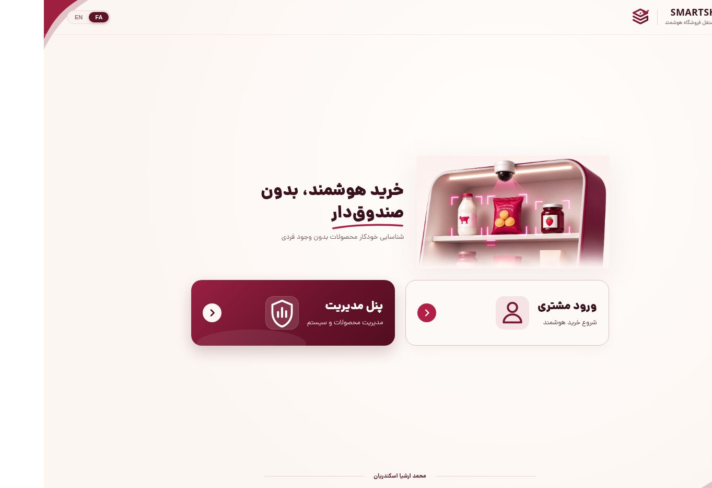
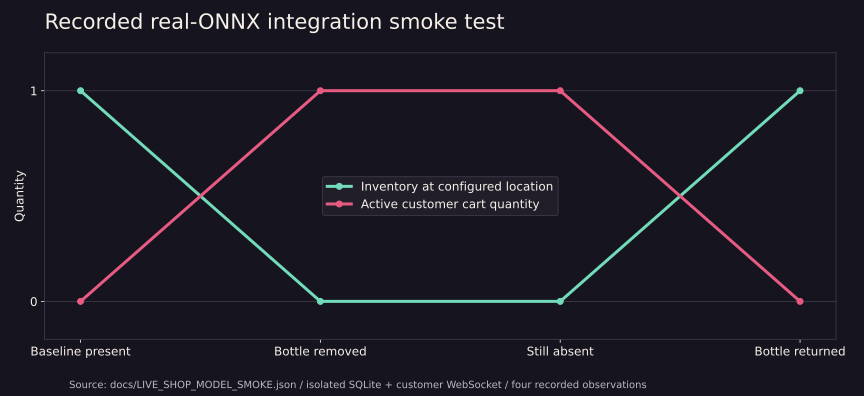
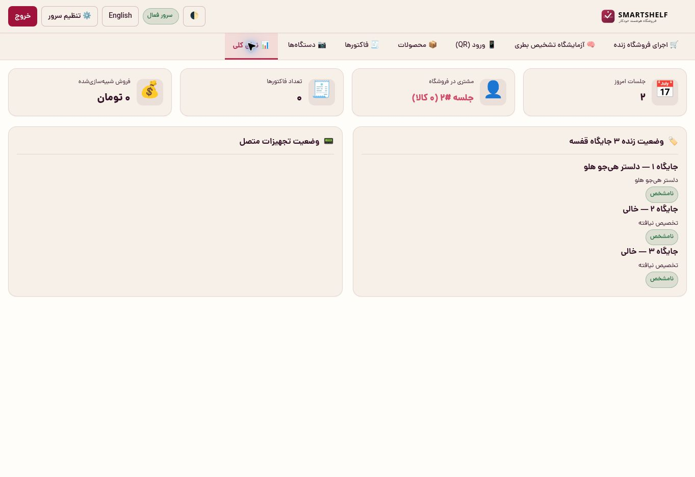
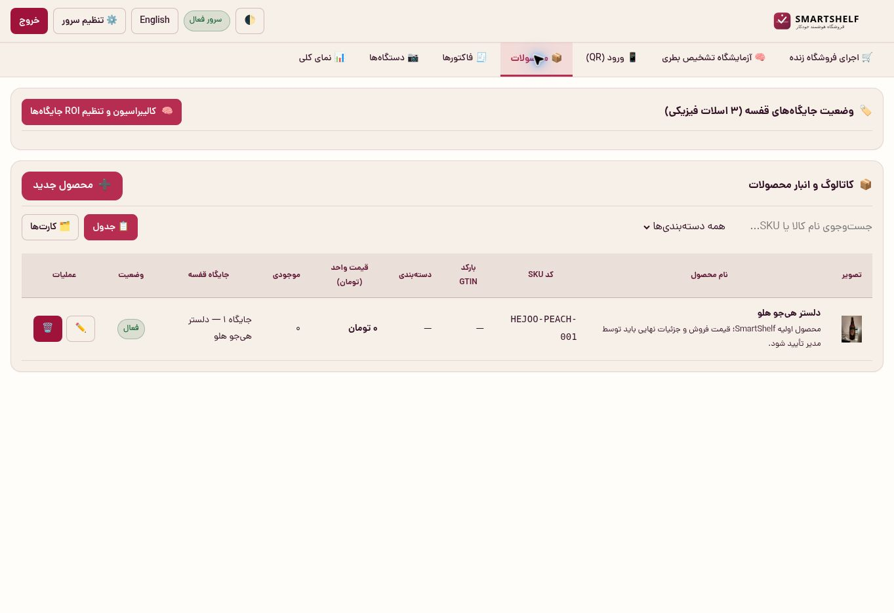
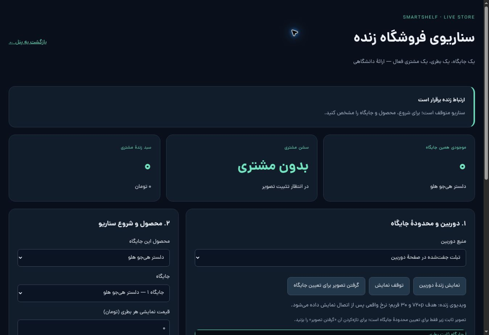
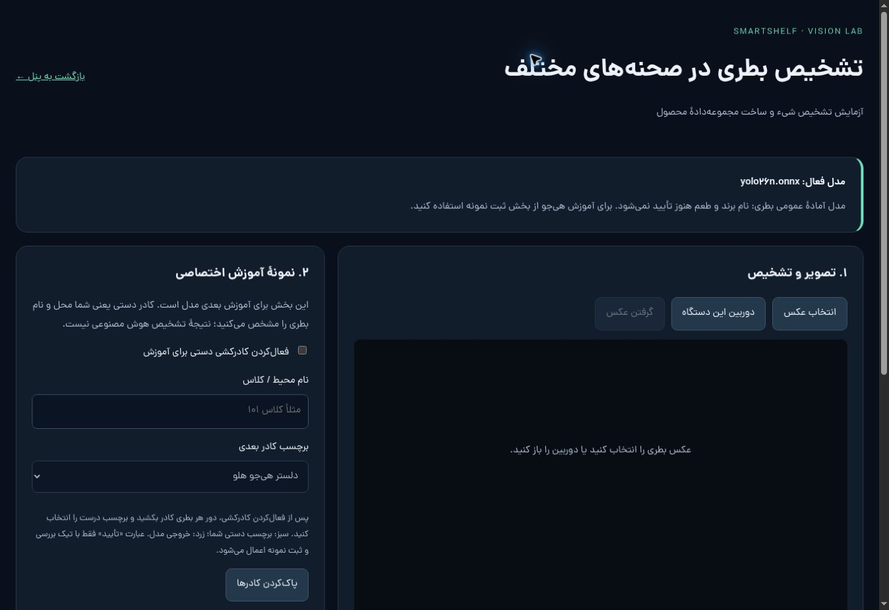
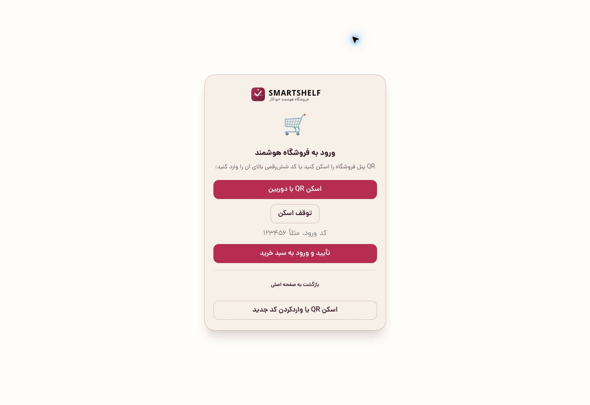
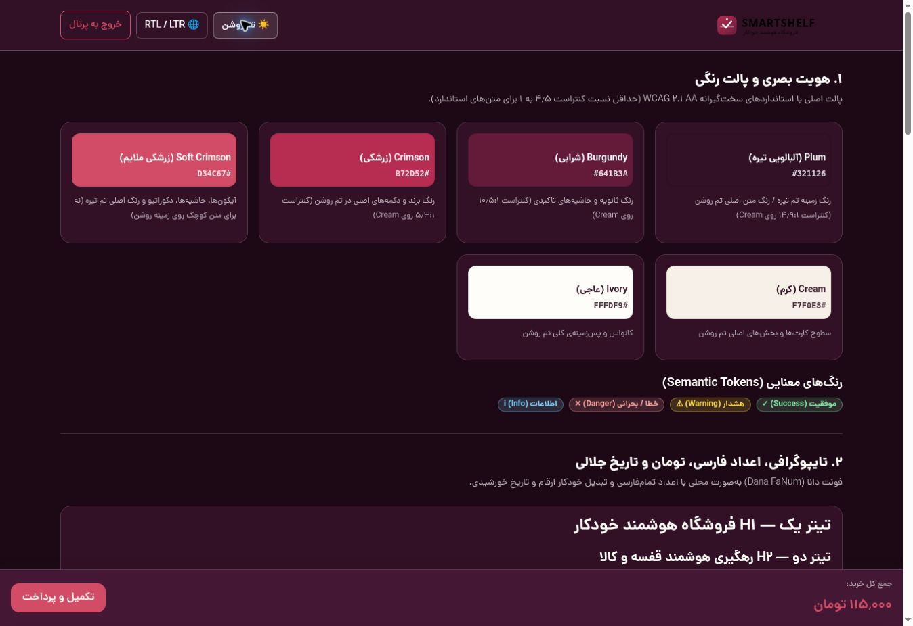
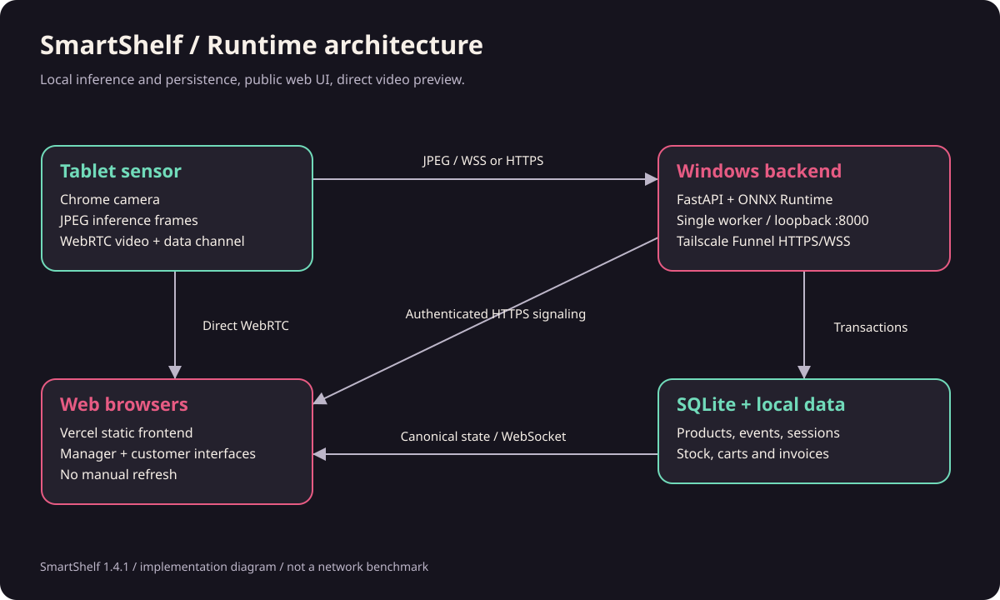

<div align="center">


# SmartShelf

### A real-time, camera-assisted cashierless-store prototype

**Tablet camera · Local computer vision · Live carts & inventory · WebRTC**

[](CHANGELOG.md)
[](requirements.txt)
[](docs/ARCHITECTURE.md)
[](docs/MODEL_CARD.md)

[فارسی](README.fa.md) · [Visual tour](docs/GALLERY.md) · [Architecture](docs/ARCHITECTURE.md) · [Installation](docs/SETUP.md) · [Development story](docs/DEVELOPMENT_JOURNEY.md)

</div>



## What this project does

SmartShelf demonstrates a small cashierless shopping loop with an ordinary tablet and a Windows computer. A customer enters using a manager-generated QR or short-lived code. The tablet watches a configured bottle location. Stable removal adds the assigned product to that customer's cart and decreases inventory; a stable return reverses the cart change and restores inventory. Manager and customer screens update without manual refresh.

The project began with present/empty reference-image matching. Classroom portability exposed background and camera-position sensitivity, so the active scenario evolved toward a pretrained bottle detector, conservative temporal confirmation and separate transport paths for high-FPS video, inference frames and store state.

**Current supported scenario: one bottle location, one assigned product and one active customer.** Generic bottle recognition does not establish a bottle's brand or flavor. Product identity and price come from the configured location. This is a university demonstration with no bank-payment integration, not an autonomous multi-person retail deployment.

## Demonstration flow

| Action | Inventory | Active customer's cart |
| --- | --- | --- |
| First stable bottle observation | Baseline becomes 1 | No purchase |
| Customer enters through QR/code | Unchanged | Session opens |
| Bottle is stably removed | 1 → 0 | Add one assigned product |
| Bottle is stably returned | 0 → 1 | Remove that product |
| Camera becomes ambiguous/offline | Continuity breaks; review may be required | No speculative charge |



## Capabilities

- **Portable object detection:** local YOLO26n ONNX inference with OpenCV/NumPy preprocessing and normalized boxes; empty-reference capture is not required by the current bottle scenario.
- **Temporal confirmation:** stable observations and frame-count thresholds; explicit unknown states, source ownership, monotonic sequences and recovery across gaps.
- **Real-time accounting:** server-authoritative SQLite transactions, events, shopping sessions, carts and invoices; live WebSocket updates.
- **Tablet pairing:** one-use six-digit pairing codes, signed device-bound credentials, Persian/Arabic numeral normalization and separate customer-entry credentials.
- **Resilient inference transport:** authenticated WSS, negotiated frame acknowledgments/backpressure and HTTPS fallback feeding the same vision pipeline.
- **Smooth live preview:** native WebRTC video, authenticated HTTPS signaling, ICE negotiation, actual receiver FPS/resolution, track replacement and explicit TURN configuration.
- **Real Start/Stop controls:** reliable WebRTC data-channel commands acknowledged by the tablet, followed by same-device server-frame verification. Preview and inference are separate.
- **Vision lab:** explicit image detection, opt-in manual annotation, reviewed dataset export, environment-aware dataset splitting and future custom-training tooling.
- **Management UI:** catalog, GTIN validation, product images, physical zones/ROI, entry codes, devices, sessions, invoices and design-system components.
- **Local deployment tooling:** Windows installation, secure environment preparation, diagnostics, backup, autostart registration and Tailscale Funnel setup.
- **Bilingual interface/documentation:** Persian RTL and English UI, localized digits, Toman formatting and Jalali dates. The public source bundles the redistributable Vazirmatn font.

## Visual tour

These are actual interface captures. The live-store screenshot shows a stopped scenario and the vision-lab screenshot shows an idle detector page; they are not presented as live recognition results. The styleguide contains explicit sample data. No active entry QR, credentials or private reference-photo archive is published.

| Manager dashboard | Product catalog |
| --- | --- |
|  |  |

| Store scenario | Vision lab |
| --- | --- |
|  |  |

| Customer entry | Dark design system |
| --- | --- |
|  |  |

See the [full gallery and image provenance](docs/GALLERY.md), including English home and light-theme design-system views.

## Architecture



| Layer | Technology | Why it exists |
| --- | --- | --- |
| Web interfaces | HTML5, CSS, vanilla JavaScript, Canvas | Tablet/admin/customer flows with no frontend build requirement |
| API/runtime | Python, FastAPI, Uvicorn, Pydantic | Validated HTTP/WebSocket endpoints and a persistent backend |
| Storage | SQLAlchemy, SQLite | Local durable catalog, sessions, inventory, carts and invoices |
| Vision | YOLO26n ONNX, ONNX Runtime, OpenCV, NumPy, Pillow | CPU object detection, preprocessing and image handling |
| Legacy vision | SIFT/ORB, RANSAC, MobileNetV2 catalog embeddings | Earlier reference/identity research paths; not a claim of validated brand recognition |
| Real-time video | WebRTC, RTCDataChannel, STUN/optional TURN | Direct preview video and acknowledged tablet controls |
| Inference/state transport | WSS, HTTPS, WebSockets | Authenticated frames and canonical live stock/cart updates |
| Code scanning | zxing-cpp, vendored jsQR | Product barcode handling and customer QR scanning |
| Operations | PowerShell/batch, Tailscale Funnel, Vercel | Windows local backend and HTTPS/WSS access with a static web frontend |
| Verification | pytest, executable Node harnesses | Accounting/security/transport regressions and frontend logic checks |

The backend runs as **one worker** on the Windows host, bound to `127.0.0.1:8000`. Vercel hosts only the static frontend. Funnel provides public HTTPS/WSS; it is not a TURN media relay. Images explicitly saved as product assets/training samples persist locally; continuous raw video/inference frames are not recorded.

## Start on Windows

```powershell
git clone https://github.com/arschia/SmartShelf.git C:\SmartShelf
cd C:\SmartShelf
.\INSTALL-SMARTSHELF.bat
.\START-SMARTSHELF.bat
```

The Windows installer targets **64-bit Python 3.14**, creates `.venv`, installs pinned dependencies and prepares private configuration. Install/sign in to Tailscale and explicitly run `ENABLE-FUNNEL.bat` for public HTTPS. Configure **your own** backend URL and exact frontend CORS origin. This checkout deliberately does not connect to the owner's personal backend.

Follow [the full setup guide](docs/SETUP.md). Keep `.env`, generated credentials, SQLite files, backups and private photos out of Git. The normal store starts closed; enable the explicitly configured university scenario for the demonstration. Do not open router port 8000.

### Main pages

| Path | Role |
| --- | --- |
| `/` | Persian/English home |
| `/admin/` | Manager panel |
| `/camera/` | Paired tablet sensor |
| `/shop` | Current single-bottle live-store scenario |
| `/enter/` | Customer QR/manual-code admission |
| `/customer/` | Live shopping session/cart |
| `/bottle` | Detection and annotation laboratory |
| `/presence` | Legacy two-reference calibration tool |
| `/styleguide/` | Design-system examples |
| Backend `/docs` | Generated OpenAPI interface |

The owner's demonstration frontend is https://shelf-ir.vercel.app. It depends on an owner-operated backend and is not a public hosted service or guaranteed always-on demo. No admin credentials are provided here.

## Project layout

| Directory/file | Contents |
| --- | --- |
| `backend/app/` | API routes, authentication, DB models, services, state machine, vision and WebSockets |
| `backend/tests/` | Backend regressions with isolated test configuration |
| `frontend/` | Static interfaces, shared API/RTC modules, images, fonts and Vercel routing |
| `ai/models/` | Bundled ONNX model files and third-party model notices |
| `ai/train_bottle.py`, `ai/SmartShelf-Bottle-Training.ipynb` | Optional custom-training path |
| `scripts/` | Windows/network/install/backup diagnostics and executable UI harnesses |
| `docs/` | Architecture, model card, API, configuration, journey, gallery and validation evidence |
| `.github/` | Source checks, bug report and PR templates |
| `.env.example` | Configuration placeholders; not working credentials |

## Validation status

The recorded backend run passed **160 tests**. Eight Node harnesses exercise actual frontend logic at controlled browser/network boundaries. A real bundled-ONNX isolated integration smoke test verified stock/cart transitions and WebSocket events. The owner reported the physical setup working after the 1.4.1 fix on 5 November 2026.

These are separate evidence levels. A UI harness is not a physical-tablet FPS benchmark; 39 reference images with detections out of 42 supplied images is not mAP or held-out recall. Read [testing](docs/TESTING.md), the [model card](docs/MODEL_CARD.md) and the [machine-readable validation summary](docs/validation/summary.json).

```bash
python -m pytest backend/tests -q
python scripts/check_frontend_paths.py
node scripts/test_rtc_ui.cjs
node scripts/test_shop_tablet_controls.cjs
```

CI is configured for source integrity and the eight dependency-free UI harnesses. Backend/model validation is documented separately; a workflow definition alone is not evidence of a successful CI run.

## How it evolved

| Milestone | Engineering change |
| --- | --- |
| Reference baseline | Present/empty ROI matching plus conservative temporal state |
| 1.2.0 | Portable pretrained bottle detector and opt-in dataset tooling |
| 1.3.0 | Live inventory/cart/customer-session scenario |
| 1.3.1 | Signed camera credentials, frame acknowledgments, HTTPS fallback and QR scanning |
| 1.3.2 | Correct camera-startup error diagnosis |
| 1.4.0 | Native WebRTC preview replacing snapshot viewing |
| 1.4.1 | Acknowledged tablet Start/Stop plus server-frame confirmation |

Read [the complete development narrative](docs/DEVELOPMENT_JOURNEY.md). Milestones describe prior work; they are not fabricated Git commits.

## Scope and next steps

Multi-customer attribution, multiple bottles per slot, SKU/brand recognition, payment integration, arbitrary-network WebRTC reliability, independent classroom benchmarks and production retail certification are outside the current validated scope. Custom-training tools exist; a validated brand-specific trained model does not.

See [troubleshooting](docs/TROUBLESHOOTING.md), [security/privacy](SECURITY.md), [contributing](CONTRIBUTING.md) and [third-party notices](THIRD_PARTY_NOTICES.md). Existing third-party licenses remain applicable; no blanket relicense of all project/third-party assets is asserted.

**Project by Mohammad Arshia Eskandarian — [@arschia](https://github.com/arschia).**
