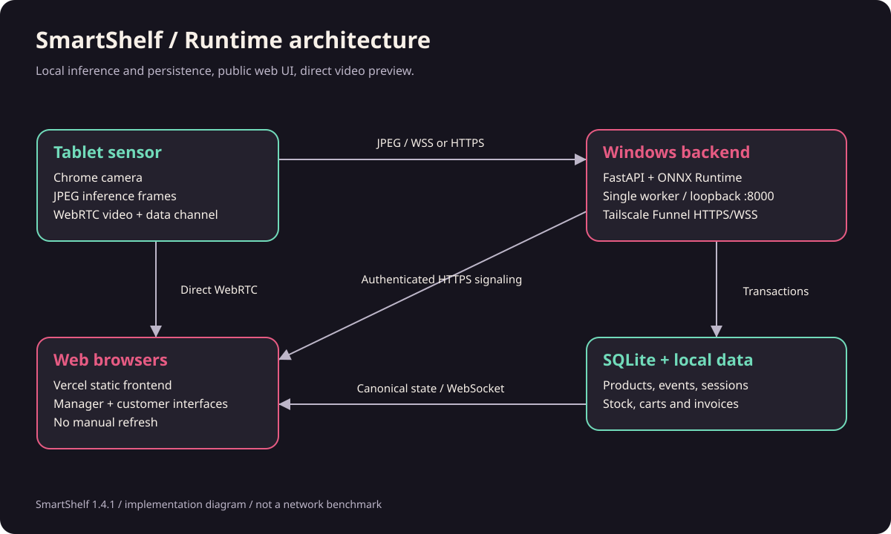
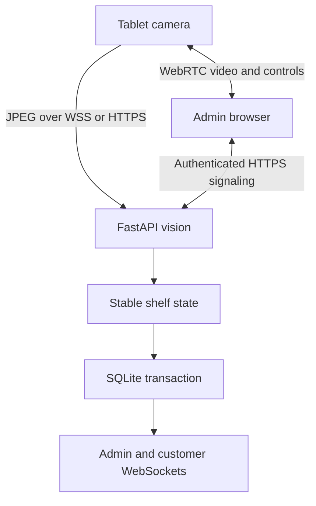
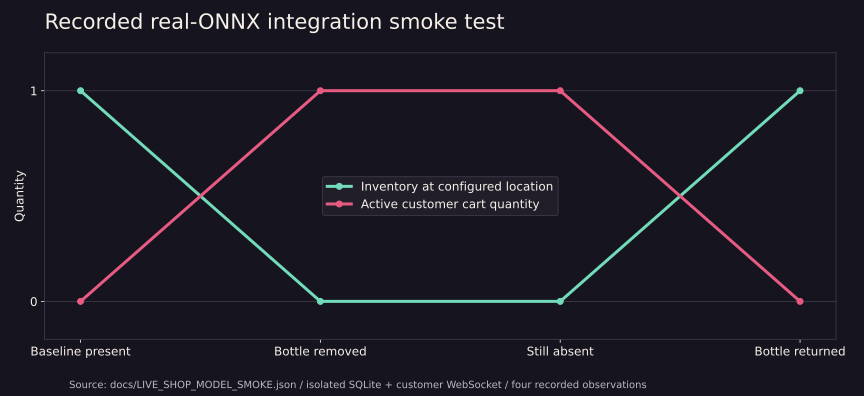

# Architecture and data flow

SmartShelf is a single-store university prototype with separate **video viewing**, **vision processing**, and **accounting** paths. A smooth video alone does not prove that the backend has received a frame for inference.

## Components

| Component | Responsibility | Implementation |
| --- | --- | --- |
| Tablet sensor | Camera capture, JPEG inference frames, WebRTC video and remote processing controls | `frontend/camera/app.js` |
| WebRTC module | Offer/answer/ICE, receiver statistics, track replacement, acknowledged data-channel controls | `frontend/assets/js/rtc.js` |
| Signaling broker | Authenticate both parties, device binding, bounded transient message queues | `backend/app/routes/rtc.py` |
| Vision | Letterbox preprocessing, ONNX inference, class filtering, ROI occupancy | `backend/app/vision/bottle_detector.py`, `services/shop_scenario.py` |
| Temporal state | Require stable observations; reject ambiguity, gaps and duplicate/out-of-order frames | `vision/state_machine.py`, `services/shop_scenario.py` |
| Store services | Entry tokens, one active shopping session, stock, cart and invoices | `routes/entry.py`, `services/session_service.py`, `services/event_service.py` |
| Persistence | Products, zones, references, sessions, events, cart and invoice records | SQLAlchemy + SQLite |
| Admin/customer updates | Push canonical server state to browsers | `backend/app/ws.py`, `/ws/admin`, `/ws/customer` |
| Deployment | Windows loopback backend, public HTTPS/WSS tunnel, static web frontend | PowerShell, Tailscale Funnel, Vercel |

## Three independent channels

1. **Inference:** the paired tablet sends compressed JPEG frames through authenticated WSS. An HTTPS upload path is available when WSS cannot remain connected. Both enter the same server-side processing function. Capture targets about 5 FPS; HTTP fallback is throttled and backpressure prevents unbounded queues.
2. **Viewing:** native `RTCPeerConnection` delivers a video track from tablet to admin. HTTPS handles authenticated signaling. Target capture is 1280×720 at 30 FPS, with an outgoing bitrate ceiling of 2.5 Mbit/s per viewer. Actual received FPS is measured with `getStats()` and is device/network dependent.
3. **Control/state:** a reliable WebRTC data channel requests inference-frame start/stop and receives an acknowledgment from the tablet. The admin then checks increasing server frame counts for the **same device ID**. WebSockets deliver authoritative cart/stock changes independently of that preview.

## Store accounting

The current scenario has one configured bottle location, one assigned product and one active customer. The generic detector supplies object presence; the administrator supplies the product identity and price. It is not a multi-person tracking or SKU recognition system.

| Stable transition | Stock | Customer cart |
| --- | --- | --- |
| First confirmed bottle presence | Establish baseline at 1 | Unchanged |
| Present → absent with the same active session throughout confirmation | 1 → 0 | Add one assigned product |
| Absent → present while the owning session is still active | 0 → 1 | Remove the corresponding cart item |
| Change without an eligible customer | Update allowed inventory observation | Never charge a different customer |
| Ambiguous observation / stream gap / session switch | Break confirmation continuity | No speculative charge |

Confirmation requires at least 3 observations and 1.2 seconds in the live scenario. A gap longer than 2.5 seconds breaks continuity. A change across a gap can require review rather than retroactive billing. A source owner and frame sequence protect against overlapping camera streams and duplicate submissions.

## Persistence and recovery

SQLite and user-uploaded assets remain on the Windows host, normally in `data/`. Stock/cart changes and events are server-side operations; browser local storage is not the source of truth. On restart, migrations run and temporal vision state returns to an unknown/baseline state. Camera credentials are signed and device-bound with a 30-day lifetime. In-memory WebRTC sessions expire; a viewer reconnects instead of persisting SDP/ICE.

Use one backend worker. SQLite plus in-memory signaling/runtime state is not a horizontally replicated deployment. The code includes cloud packaging, but the documented working deployment is Windows + Funnel.

## Network boundaries

The Windows process binds to `127.0.0.1:8000`; do not expose that port on a router. Funnel provides public HTTPS/WSS. Serve is private-tailnet access and is not interchangeable with Funnel. WebRTC has its own ICE connectivity: Funnel is not TURN. Same-LAN peers often connect directly; restrictive or separate networks may require an explicitly configured TURN service.

The default STUN endpoint discovers routes and does not carry video. `RTC_ICE_SERVERS` can configure a deployment's own STUN/TURN endpoints. No paid relay is provisioned by this repository.
