# Visual tour / گالری تصویری

Actual web-interface screenshots captured on 5 November 2026 from the project owner's deployed frontend. They show the displayed state at capture time; no live detection result or FPS measurement is fabricated. The screenshot font belongs to the original deployed UI; the public source ships the redistributable Vazirmatn font. No private reference-photo collection is published.

## 1. Persian home

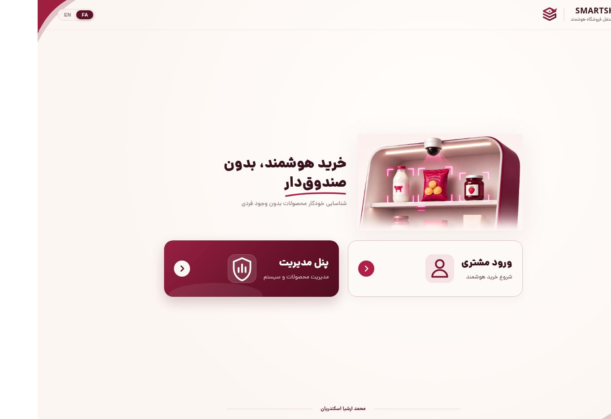

The bilingual entry point separates manager and customer flows.

## 2. English home

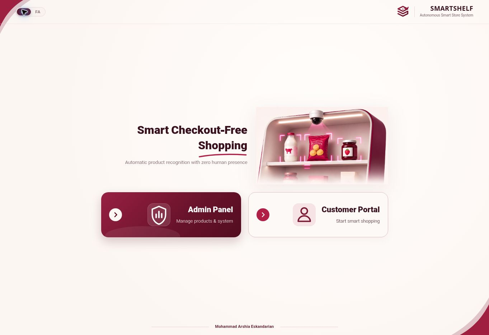

The same interface switches language and text direction.

## 3. Manager overview

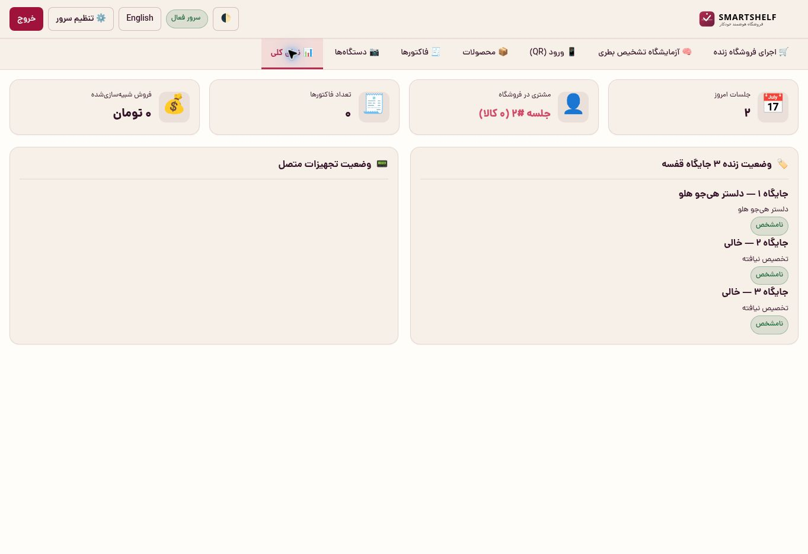

Actual displayed demonstration counters and zone status. Unknown shelf state is shown explicitly; these are not claimed to be production sales metrics. No customer identity or credential is included.

## 4. Catalog

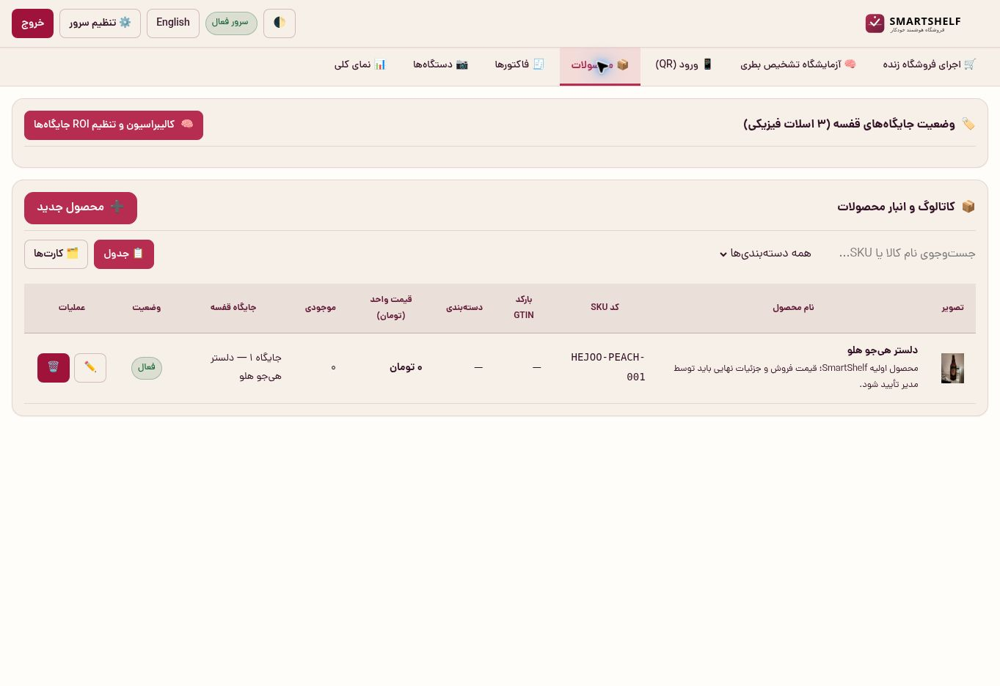

The assigned demonstration bottle, catalog fields, stock and physical location.

## 5. Live-store setup

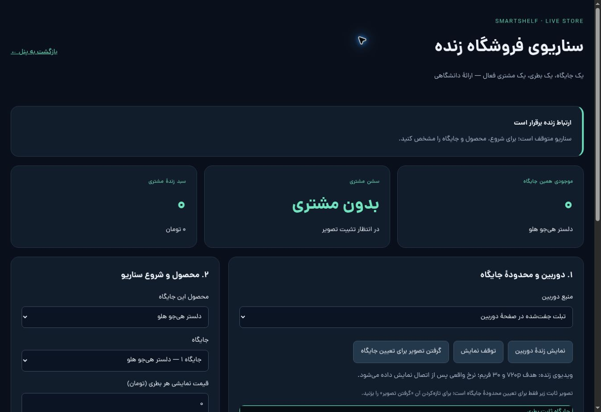

The supported one-location scenario. This capture is in stopped/setup state, without an active entry QR or a live camera preview. The ROI still-image area is intentionally distinct from video.

## 6. Bottle vision lab

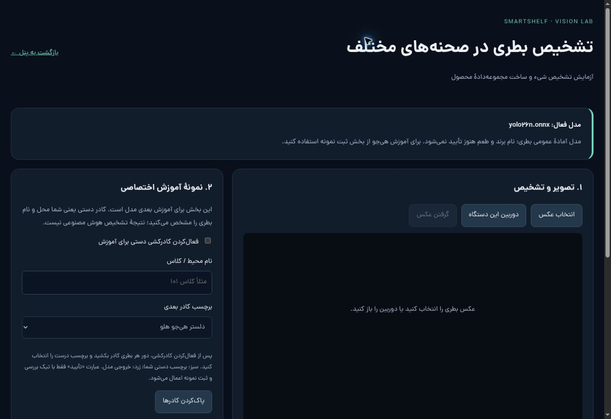

The actual model-ready interface in idle state. Manual reviewed annotations are separate from model predictions. An idle screenshot is not a demonstration of recognition accuracy.

## 7. Customer gateway

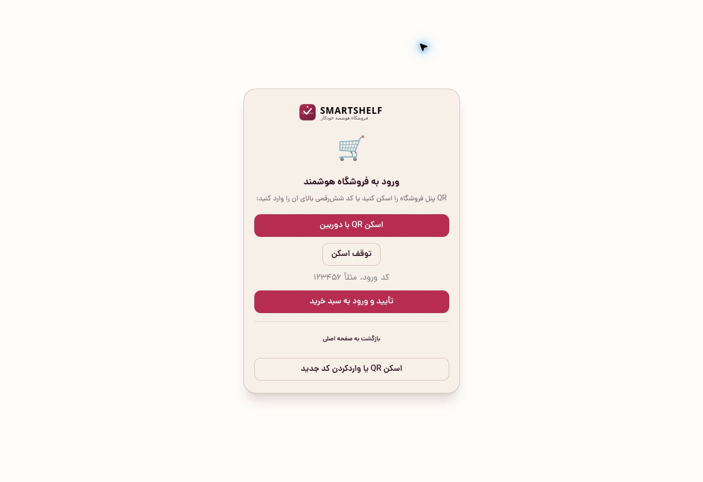

QR scanning or manual entry of a short-lived code. The field is empty in this capture; no working entry token is published.

## 8. Light design system

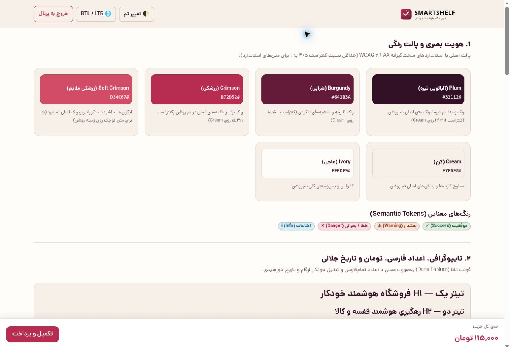

Semantic tokens, typography and control samples. Styleguide values are illustrative data.

## 9. Dark design system

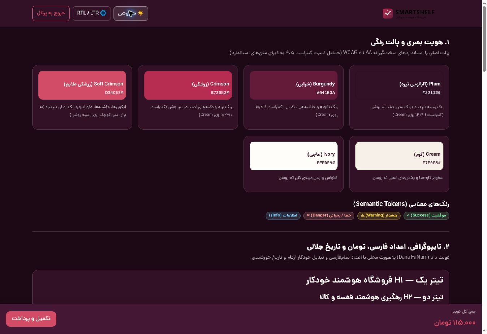

The same design-system page in the alternate theme, with illustrative data.

## 10. System architecture

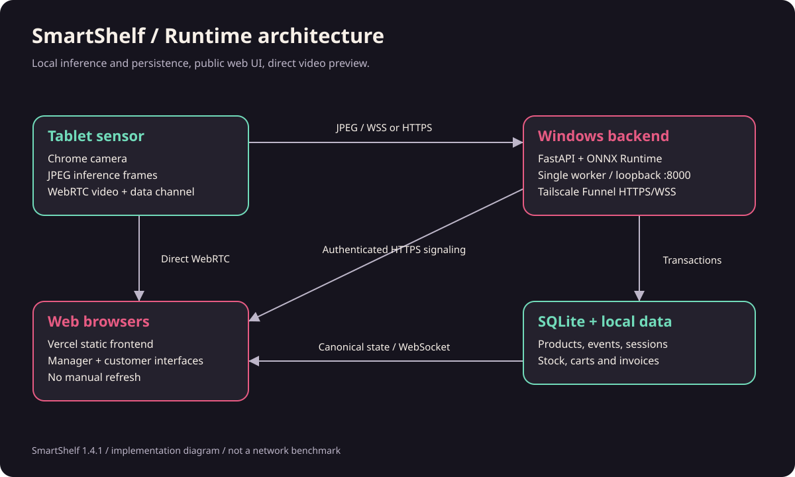

An authored technical diagram grounded in the implementation, not a screenshot.

## 11. Independent video and inference paths

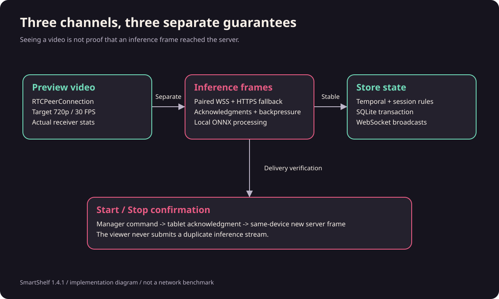

WebRTC preview and controls do not replace authenticated inference-frame delivery.

## 12. Recorded stock/cart transitions

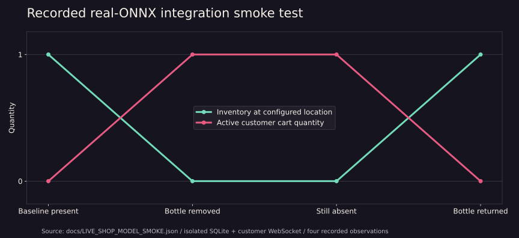

Plot of `LIVE_SHOP_MODEL_SMOKE.json`, an isolated real-ONNX/DB/WebSocket integration smoke test. These four transitions are not a large-sample accuracy benchmark.
