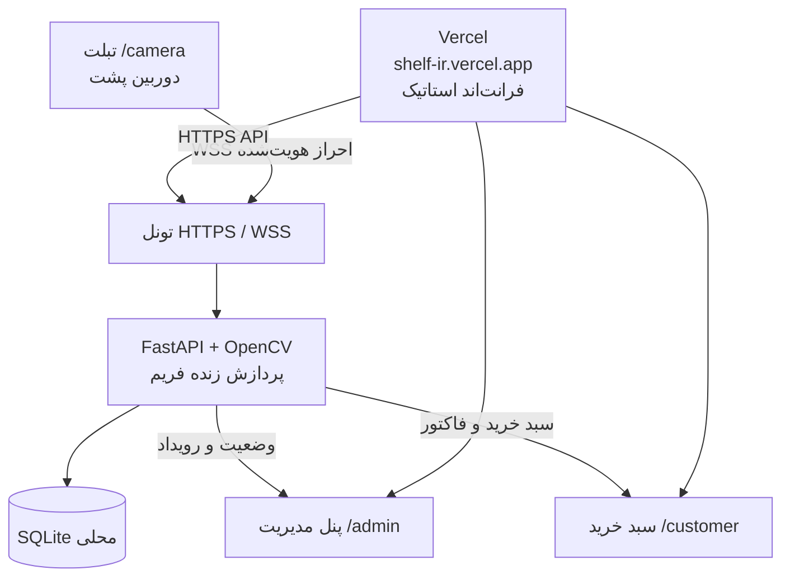

# مستندات فنی SMARTSHELF

> **دامنه فرانت‌اند عمومی:** https://shelf-ir.vercel.app  
> **وضعیت این مستند:** مبنای معتبر معماری و سورس پس از یکپارچه‌سازی دو مرجع  
> **معماری استقرار:** فرانت‌اند استاتیک روی Vercel؛ بک‌اند FastAPI و پردازش تصویر روی میزبان پایدار فروشگاه از طریق HTTPS/WSS تونل‌شده با Tailscale Funnel.

## ۱. هدف سامانه

SmartShelf سامانه‌ای برای پایش جایگاه‌های قفسه، تشخیص برداشتن/بازگرداندن محصول و همگام‌سازی رویدادهای تأییدشده با سبد خرید مشتری است. سامانه از تشخیص چهره استفاده نمی‌کند. فریم‌های خام دوربین در حافظه بک‌اند پردازش می‌شوند و نباید روی دیسک یا Vercel ذخیره شوند.

## ۲. معماری معتبر

Vercel فقط رابط استاتیک را میزبانی می‌کند. پردازش دوربین، دیتابیس و WebSocket به بک‌اند دائمی نیاز دارند؛ بنابراین بک‌اند باید روی لپ‌تاپ یا Mini PC فروشگاه اجرا و از طریق تونل HTTPS/WSS در دسترس قرار گیرد. هیچ کانال عمومی ntfy یا سرویس PeerJS برای انتقال تصویر/سبد خرید در مسیر عملیاتی استفاده نمی‌شود.

## ۳. تشخیص دو مرجعی حضور/برداشت

هر جایگاه با دو مرجع کالیبره می‌شود:

- `PRESENT`: تصویر جایگاه در حالی که محصول در محل صحیح قرار دارد.
- `ABSENT`: تصویر همان جایگاه پس از برداشتن محصول.

موتور `backend/app/vision/two_reference.py`:
- ویژگی‌های SIFT و تطبیق هندسی RANSAC را به کار می‌گیرد؛ در نبود SIFT از ORB استفاده می‌کند.
- در زمان کالیبراسیون، ویژگی‌های مرجع را استخراج و در فیلدهای مرجع همان Zone ذخیره می‌کند.
- تصاویر خام را در دیتابیس نگه نمی‌دارد.
- برای هر فریم زنده یکی از `PRESENT`، `ABSENT` یا `UNKNOWN` را برمی‌گرداند.
- در نبود هر دو مرجع، اختلاف کم دو مرجع، تطبیق ناکافی یا زاویه/صحنه نامطمئن، `UNKNOWN` می‌دهد.

صفحه `frontend/presence.html` در تب تشخیص پنل ادمین قرار گرفته است. مدیر می‌تواند از فریم زنده تبلت مرجع حاضر و خالی ثبت کند، ROI را مشخص کند و کالیبراسیون را در سرور ذخیره نماید.

## ۴. اتصال به پایپ‌لاین اصلی

`backend/app/vision/pipeline.py` دو قالب مرجع را پشتیبانی می‌کند:
- مرجع قدیمی HSV/thumbnail برای حفظ سازگاری داده‌های قبلی.
- مرجع جدید SIFT/ORB + RANSAC برای کالیبراسیون دو مرجعی.

پس از تغییر کالیبراسیون، ماشین حالت Zone به `UNKNOWN` بازنشانی می‌شود تا ابتدا وضعیت مبنای فعلی قفسه را تثبیت کند. فریم `UNKNOWN` پنجره زمانی تأیید را قطع می‌کند. زمان پایداری از `STABLE_SECONDS` خوانده می‌شود.

آزمایش دستی endpoint `/api/presence` فقط وضعیت و تشخیص را برمی‌گرداند و سبد خرید را تغییر نمی‌دهد. رویدادهای خرید فقط از پایپ‌لاین زنده بک‌اند و پس از تأیید ماشین حالت عبور می‌کنند.

## ۵. شناسایی هویت محصول

تشخیص حضور/خالی بودن جایگاه، هویت محصول را تعیین نمی‌کند. شناسایی هویت از موتور ONNX/MobileNet و داده‌های محصول جداست.

آخرین گزارش ارزیابی همراه فایل پروژه روی ۲۰ نمونه، دقت Top-1 برابر ۵۰٪ ثبت کرده است. بنابراین این موتور هنوز برای صورتحساب خودکار قابل اتکا نیست. لازم است تصاویر واقعی متنوع از هر SKU جمع‌آوری، معیارهای precision/recall و confusion matrix دوباره اندازه‌گیری و آستانه‌های پذیرش تنظیم شوند. تا آن زمان خروجی شناسایی محصول باید بازبینی شود.

## ۶. امنیت و احراز هویت

- ورود مدیر با PIN قوی و توکن HMAC امضاشده انجام می‌شود.
- عمر توکن و کوکی مدیر از `TOKEN_TTL_SECONDS` پیروی می‌کند.
- PIN کوتاه یا پیش‌فرض در محیط Production پذیرفته نمی‌شود.
- دوربین فقط با کد جفت‌سازی یک‌بارمصرف و توکن دستگاه به `/ws/camera` متصل می‌شود.
- حجم و ابعاد فریم ورودی محدود شده‌اند.
- فریم قدیمی دوربین پس از ۱۰ ثانیه بدون دریافت تصویر جدید، به‌عنوان فریم زنده ارائه نمی‌شود.
- در صورت قطع بک‌اند، صفحات ورود/سبد/دوربین نباید نشست، فاکتور یا رویداد شبیه‌سازی‌شده ایجاد کنند.
- `.env`، دیتابیس، کلید خصوصی و گواهی‌ها نباید در بسته انتشار عمومی باشند.

## ۷. مسیرهای فرانت‌اند

| مسیر | کاربرد |
|---|---|
| `/` | پرتال اصلی |
| `/admin/` | پنل مدیریت |
| `/camera/` | حسگر دوربین تبلت |
| `/customer/` | سبد خرید مشتری |
| `/enter/` | اعتبارسنجی توکن QR |
| `/presence?embed=admin` | ابزار کالیبراسیون دو مرجعی درون پنل |
| `/demo/` | شبیه‌ساز مستقل و صریح دمو؛ جدا از مسیر عملیاتی |

## ۸. ساختار مهم سورس

- `backend/app/main.py`: اپلیکیشن FastAPI و WebSocketها.
- `backend/app/routes/presence.py`: API احراز هویت‌شده کالیبراسیون/آزمایش دو مرجعی.
- `backend/app/vision/two_reference.py`: استخراج ویژگی، RANSAC و تصمیم سه‌حالته.
- `backend/app/vision/pipeline.py`: ادغام موتور جدید با جریان فریم زنده.
- `backend/app/vision/state_machine.py`: تثبیت زمانی و جلوگیری از رویداد لحظه‌ای.
- `backend/app/vision/camera_feed.py`: بافر فریم در حافظه و کنترل ابعاد/حجم.
- `frontend/presence.html`: رابط ثبت دو مرجع و تست فریم تبلت.
- `frontend/admin/`: پنل مدیریت و iframe ابزار تشخیص.
- `frontend/camera/`: صفحه ارسال فریم تبلت.
- `frontend/customer/`: نمایش سبد خرید مبتنی بر بک‌اند.
- `frontend/config.js`: تنظیم آدرس API بک‌اند.
- `frontend/vercel.json`: مسیرهای استاتیک و هدرهای Vercel.

## ۹. تنظیم Production در بسته Windows Local

در اجرای Production، `main.py` از `seed_store_data` استفاده می‌کند: تنها محصول اولیه «دلستر هی‌جو هلو» به‌صورت غیرفعال و با قیمت صفر ثبت می‌شود؛ از سه جایگاه ثابت فقط جایگاه اول به این محصول تخصیص دارد و دو جایگاه دیگر خالی هستند. قیمت و فعال‌سازی باید توسط مدیر انجام شود. شناسایی هویت محصول نیز با مسیر مدل غیرفعال‌شده تا زمان اعتبارسنجی embedding اختصاصی خاموش است؛ موتور دو‌مرجعی حضور/خالی مستقل و فعال می‌ماند.

## ۱۰. وضعیت اعتبارسنجی این نسخه

- Python compileall: موفق.
- بررسی syntax فایل‌های اصلی JavaScript با Node: موفق.
- آزمون‌های موتور دو مرجعی با صحنه مصنوعی، تغییر نور/پرسپکتیو و صحنه نامرتبط: ۴ آزمون موفق.
- آزمون‌های occupancy و state machine: ۶ آزمون موفق.
- آزمون‌های امنیت PIN و توکن HMAC: ۲ آزمون موفق.
- آزمون مستقیم چرخه API کالیبراسیون، تشخیص و پاک‌کردن مرجع در SQLite موقت: موفق.
- بررسی استقرار فرانت‌اند: موفق.
- کل مجموعه تست‌ها هنوز اجرا نشده است؛ محیط فعلی وابستگی‌های `onnxruntime` و `zxingcpp` را ندارد.
- آزمایش واقعی دوربین تبلت و بک‌اند از طریق تونل هنوز انجام نشده است.

## ۱۱. موانع باقی‌مانده پیش از انتشار عملیاتی

1. ایجاد URL ثابت HTTPS/WSS برای بک‌اند و ثبت آن در `.env` و `frontend/config.js`.
2. جایگزینی PIN چهاررقمی موجود در فایل محیطی قبلی با PIN قوی جدید.
3. آزمایش دوربین واقعی تبلت در محل قفسه و تنظیم ROI برای هر جایگاه.
4. گردآوری تصاویر واقعی بیشتر برای مدل شناسایی هویت محصول و افزایش دقت آن.
5. اجرای کل تست‌ها در محیط نصب کامل وابستگی‌ها.
6. پس از موفقیت موارد بالا، انتشار نسخه فرانت‌اند و راه‌اندازی بک‌اند عمومی.

**این مستند جایگزین توضیحات قدیمی درباره انتقال تصویر با PeerJS، حالت مستقل Vercel و تشخیص سمت مرورگر است.**
